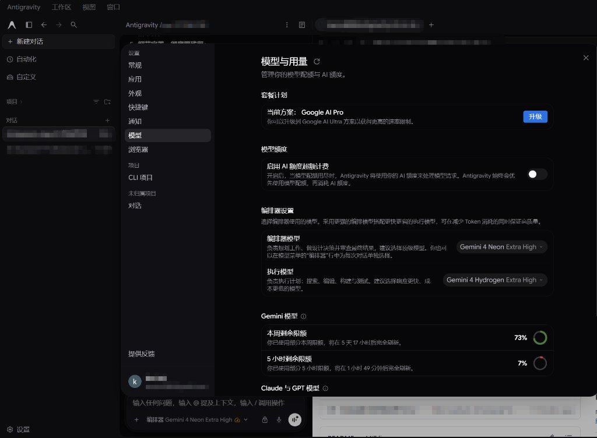

# Antigravity 简体中文汉化包（极简无损动态注入版）


专为 Windows 桌面端 **Antigravity** 打造的极简纯净、零第三方依赖、非侵入式简体中文汉化工具。无需修改官方安装目录文件，不改变原版主题配色与字体，不覆盖原英文入口，解压后双击一次批处理即可同时保留中英双入口，支持 `Ctrl + Alt + L` 一键即时切换与自定义词典热更新。

---

## 汉化效果预览



> 保留 Antigravity 官方原版深色主题与字体，菜单、设置面板、模型配额倒计时与输入提示全面汉化，同时完整保留 AI 模型名称英文原文。

---

## 项目特点与核心优势

相比修改主题字体或依赖复杂脚本框架的改造方案，本项目坚持“**克制、轻量、安全、零门槛**”：

1. **极简纯净，原汁原味**
   - **100% 保留 Antigravity 官方原版主题配色与字体**，不强行改动界面样式与排版，只专注把界面中文翻译做干净。
2. **零门槛、零命令行**
   - 无需安装 Git，无需记忆或输入任何终端命令；下载解压后只需双击 `创建桌面中文快捷方式.bat` 一键完成配置，自动生成独立的 **`Antigravity 中文版`** 桌面快捷方式，同时完整保留原有的英文版 **`Antigravity`** 快捷方式。
3. **无损动态注入，随官方升级自动兼容**
   - 绝不篡改官方安装目录中的 `app.asar`、`language_server.exe` 等任何原生程序文件；客户端自动更新版本后通常无需重新打补丁即可继续使用。
4. **零外部依赖，代码精简透明**
   - 零第三方 npm 依赖，仅在启动时连接本机回环地址 `127.0.0.1` 的 CDP 调试端口；不发起任何联网请求、不采集也不上传任何用户数据。全部源码简短清晰、自带自动化单元测试，人人都能快速审计。
5. **细节体验完善，彻底零残留**
   - 窗口内随时按 **`Ctrl + Alt + L`** 瞬间完成「简体中文 / 英文原版」无缝互切；
   - 严格保护 **AI 模型名称、代码块、行内代码、文件路径、命令行参数与 URL** 不被误翻；
   - 内置 **3,333 条**高覆盖中文词条与动态句式/耗时规则，支持编辑 `dict.custom.json` 保存后数秒内热更新到已打开界面；
   - 卸载只需删掉中文快捷方式与文件夹，对系统与客户端本体彻底零残留。

---

## 安全与非官方免责声明

> **重要提示**：
> 1. **非官方项目声明**：本项目为第三方开源社区工具，与 Google 或 Antigravity 官方没有任何隶属、合作或背书关系；本仓库不修改、不包含也不再分发 Antigravity 官方客户端安装包或二进制程序。
> 2. **无损动态注入机制**：启动器仅在启动客户端时传入本地调试端口参数，通过本机回环地址 `127.0.0.1`（默认端口 `19222`）上的 Chrome DevTools Protocol (CDP) 将汉化脚本注入界面渲染层。
> 3. **本地运行与零隐私收集**：整个汉化包零外部 npm 依赖，不发起任何互联网请求，不采集、不记录也不上传任何用户账号、对话或代码数据。

---

## 运行环境要求

- **操作系统**：Windows 10 / Windows 11
- **目标软件**：已安装 **Antigravity** 桌面客户端
- **运行时环境**：已安装 **Node.js 22 或更高版本**（推荐 LTS 长期支持版）
  - 官方下载：[https://nodejs.org/](https://nodejs.org/)

---

## 安装与使用步骤

1. **获取汉化包**
   - 普通用户建议前往本仓库右侧 **Releases** 下载打包好的 `antigravity-zh-cn.zip`，或直接下载本仓库全部文件。
   - **重要**：若从浏览器、网盘或聊天工具下载压缩包，建议先右键压缩包 →「属性」→ 勾选底部的「解除锁定」→「确定」，然后**务必完整解压到一个固定目录**（例如 `D:\Tools\Antigravity中文包` 或桌面固定文件夹），切勿直接在压缩软件预览窗口内双击运行。
2. **确认基础环境**
   - 确保系统已安装 Antigravity 客户端以及 Node.js 22+。
3. **一键创建桌面快捷方式**
   - 进入解压目录，双击运行 `创建桌面中文快捷方式.bat`（若弹出 Windows SmartScreen 安全提示，点击「更多信息」→「仍要运行」）。
   - 脚本会自动检测 Node.js 版本并查找 `Antigravity.exe` 图标来源，在当前用户真实桌面路径（支持 OneDrive 重定向桌面）生成 `Antigravity 中文版` 快捷方式，同时完整保留原有的英文版 `Antigravity` 快捷方式。
   - *提示：若日后移动了汉化包目录位置，重新双击运行一次 `创建桌面中文快捷方式.bat` 即可更新快捷方式指向。*
4. **启动使用**
   - 双击桌面 `Antigravity 中文版`：无黑框静默启动并自动注入简体中文界面。
   - 双击桌面原 `Antigravity`：以原汁原味的英文界面启动。

---

## 快捷键、自定义词典热更新与环境变量

### 1. 一键中英切换快捷键
在 Antigravity 窗口处于聚焦状态时，按下 `Ctrl + Alt + L` 可立即在「简体中文」与「英文原版」之间切换，无需重启软件。

### 2. 自定义覆盖词典（`dict.custom.json`）
若官方新版本新增了界面文本，或你想按个人习惯微调译文，直接编辑同目录下的 `dict.custom.json`：

```json
{
  "Some New English Label": "你的自定义中文译文",
  "Permission preset": "权限预设"
}
```

保存文件后，后台 `launcher.mjs` 会在数秒内检测变更并热重载至当前打开的窗口中。`dict.custom.json` 优先级高于内置主词典 `dict.zh-CN.json`。

### 3. 可选环境变量
| 变量名 | 说明 | 默认值 |
| --- | --- | --- |
| `ANTIGRAVITY_EXE` | 手动指定 `Antigravity.exe` 的完整路径 | 自动探测常见安装目录与快捷方式 |
| `ANTIGRAVITY_ZH_PORT` | 指定本地 CDP 远程调试端口 | `19222` |

---

## 文件清单

| 文件名 | 作用说明 |
| --- | --- |
| `launcher.mjs` | 核心启动器、Node.js 22+ 校验与本地 CDP 监听守护进程（支持热重载） |
| `injector.js` | 浏览器渲染层动态注入翻译引擎（v2，含代码块/模型名保护与正则规则） |
| `dict.zh-CN.json` | 内置简体中文主词典（3,333 条词条） |
| `dict.custom.json` | 用户自定义覆盖词典（默认为空 `{}`） |
| `launch-silent.vbs` | Windows 无黑框静默启动入口脚本 |
| `install-shortcut.ps1` | 环境检测与桌面快捷方式创建 PowerShell 脚本 |
| `创建桌面中文快捷方式.bat` | 一键以 `Bypass` 策略调用安装脚本的批处理入口 |
| `使用说明.txt` | 离线便携包中文使用说明文档 |
| `test.mjs` | 基于 Node.js 原生测试框架的词典与注入引擎自动化测试集 |
| `README.md` | GitHub 项目主页说明文档 |
| `LICENSE` | MIT 开源协议文本 |
| `.gitignore` | Git 忽略规则（排除 `launcher.log` 与系统临时文件） |
| `preview-zh-cn.jpg` | 汉化效果预览截图（用于 GitHub 首页展示） |

---

## 参与贡献与运行测试

欢迎通过 Issue 反馈漏翻或翻译瑕疵，或直接提交 Pull Request 补充完善 `dict.zh-CN.json` 与 `injector.js`。

在提交修改前，请使用 Node.js 22+ 运行内置测试套件确保全部用例通过：

```bash
node --test test.mjs
```

---

## 常见问题与零残留卸载

### Q1：点击「Antigravity 中文版」提示重启或界面未变成中文？
如果此前已通过英文快捷方式打开了 Antigravity，或系统托盘中仍有 `Antigravity.exe` 后台常驻进程，CDP 调试端口不会生效。请在弹出提示时选择允许重启切换；若仍未生效，先右键彻底退出系统托盘中的 Antigravity（或结束所有 `Antigravity.exe` 进程），再通过「Antigravity 中文版」启动。

### Q2：提示缺少 Node.js 或版本过低？
本工具使用 Node.js 22+ 原生内置的 `fetch` 与 `WebSocket` API。请前往 [https://nodejs.org/](https://nodejs.org/) 安装最新 LTS 版本即可。

### Q3：遇到端口冲突怎么办？
默认使用本机 `19222` 端口。若被占用，可在系统环境变量中设置 `ANTIGRAVITY_ZH_PORT`（例如 `19333`）。

### Q4：如何排查启动或注入异常？
运行后同目录下会生成 `launcher.log` 日志文件，打开即可查看可执行文件探测路径、词典加载条数与目标页面挂载情况。

### Q5：如何彻底卸载（零残留）？
1. 删除桌面上的 `Antigravity 中文版` 快捷方式；
2. 删除整个汉化包文件夹。  
客户端本体零改动、无注册表写入、无任何系统残留。

---

## 开源协议

本项目基于 [MIT License](./LICENSE) 开源。
